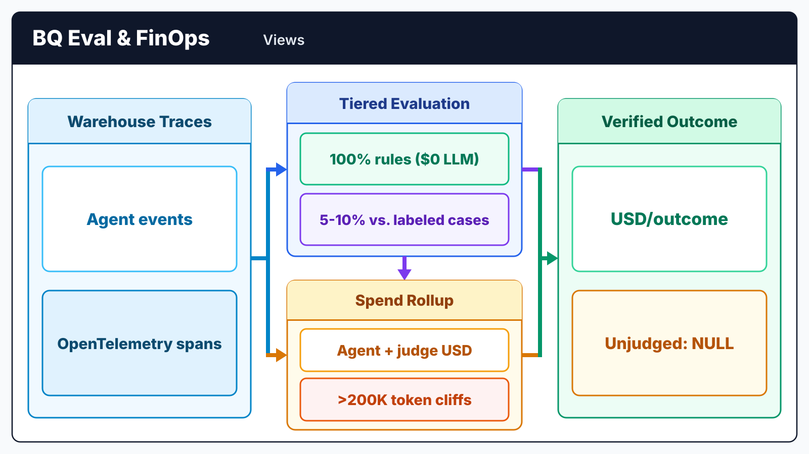

# BQ Eval: Stop Mistaking Token Spend for Working Agents

Agents don't fail loudly on monitoring dashboards: a looping tool or 200K-token PDF burns budget without finishing the job. Judging every trace with LLMs rivals production spend, and oversampling failed runs skews raw pass rates. I built BQ Eval so Day-1 BigQuery views need zero new tables, mirror in SQLite, and return NULL when unjudged.



## Verified Receipts

Static [rule views](sql/step1_trace_views.sql) (`51/51` `bq --dry_run` checks) check every trace over `agent_events` or `_AllSpans` (`32`-col [adapter parity](tests/test_m5_bqaa_dual_path.py)), while scheduled queries persist sampled LLM scores and labeled cases under a `2M` token/day [cap](sql/step3_daily_quota_guard.sql) so BI reads never re-bill judge spend. Math passes `111/111` tests (`0.0` mocks, `< 1e-12` `sqlglot` SQLite parity). Live [receipts](benchmarks/results/m2_live_receipt.json) run real agents on synthetic docs (`343` cases + `100` prior smoke runs = `443` outcomes across `28,752` spans).

| Scope | Measured Result | Proof |
| :--- | :--- | :--- |
| **Twin (`50`)** | `order-support-agent` (`40`): `38/40` (`95%`) rules, `18/20` (`90%`) sample + `0/2` tail (`81.8%` pooled vs. `87.4%` calibrated `[64.7%, 100%]`), `$0.0232`/outcome (`$0.7160` agent + `$0.0550` judge); unjudged (`10/10`) `NULL` | [SQL tests](tests/test_sql_contracts.py) |
| **KYC (`280`)** | `28/28` structural + `8/8` PO Box + `8` OCR rejects in `$0` SQL; `20/20` traps caught (`100%` `[83.9%, 100%]`, `0/216` FP = `280`); across `266` judged rows, `30/30` binary Argon match (`4`-pt `AC2 = 0.8605`, calibrated `86.84%` `[82.8%, 90.9%]`, `$0.0056`/outcome) | [Judge SQL](sql/step2_stateless_eval.sql) |
| **RFP (`35`)** | Structured (`n=8`) `$0.0000` AI vs. Flash PDF (`n=17`) `$0.00024` AI vs. `>200K` Argon PDF (`n=10`) `$0.7225` AI, flagged in `$0` SQL (mixes tier & cliff) | [Rule views](sql/step1_trace_views.sql) |
| **Skill (`18`) & shadow (`10`)** | `1.0.0` (`n=8`) to `1.1.0` (`n=10`): `$0.02427` to `$0.000915`/outcome (`96.2%` drop, excl. wages; `9/9` auto, `1/1` escalated). `10` shadow traces hit `unregistered_app` (`0%`, `NULL`) | [Views](sql/views.sql) |

[Cost model](bq_eval/engine/finops.py): on `100k` traces (`3%` tail + `5%` sample), rule screening cuts judge spend `92.2%` (`$250` to `$19.62`) while catching `100%` of tail failures missed by uniform `5%` sampling.

## Why Not Langfuse, LangSmith, Datadog, or Managed BigQuery Eval?

For prompt UIs, annotation queues, or `< 50`-trace slices where `$0` SQL rules plus manual review beat wide intervals, use Langfuse, LangSmith, or plain SQL/`dbt` (`dbt` can also schedule `bq-eval` SQL).

| Incumbent | What It Does Well | Gap `bq-eval` Fills |
| :--- | :--- | :--- |
| **Langfuse / LangSmith** | Prompt iteration, annotation UIs, dev tracing | Copies traces out of BigQuery; no warehouse rule views, debiased samples, or `>200K` cliffs |
| **Datadog LLM / Billing** | APM alerts, latency, raw token spend | Stops at cost/trace; misses verified outcomes, judge spend, and `NULL` on unjudged apps |
| **BigQuery Agent Analytics (`BQAA`) + `AI.EVALUATE_AGENT`** | 3-line capture, zero-setup turn scoring | Omits App Hub ownership, calibration, `$0` rule filtering, and outcome cost; `bq-eval` layers on top |

## Where This Breaks

1. **Synthetic docs & model labels:** Live `343` cases use synthetic docs; `4`-point `AC2 = 0.8605` (`30/30` binary match) compares `gemini-3.8-flash` to `gemini-4-argon` (`0` human labels; `[82.8%, 90.9%]` uses point judge rates). Regulated use needs `~100` blind human labels.
2. **Small slices & mixed cliffs:** Skill (`n=8` vs. `n=10`) excludes wages; RFP (`35`) mixes model tier with the `>200K` cliff.
3. **Scheduled writes, caps & dialects:** Sampled `AI.GENERATE_TABLE` scores write via scheduled queries under a daily cap so BI reads and failure spikes don't re-bill judges. `AI.EVALUATE_AGENT` runs in single regions only and estimates judge tokens from character length (`CHAR_LENGTH / 4`).
4. **Manual cloud setup:** Local runs use a `sqlglot`-verified SQLite twin; one-command BigQuery/Terraform bootstrap is on the [roadmap](docs/roadmap.md).

## Quick Start

Run the SQLite twin (`kyc-address-verification`: `86.84% [82.78%, 90.90%]`, `$0.0056`/outcome; `unregistered_app`: `NULL`):

```bash
uv sync --extra dev && uv run python -m bq_eval.cli demo
```

See `--corpus retail-2app`, `uv run pytest -p no:cacheprovider -v`, or [bq_dry_run.py](scripts/bq_dry_run.py).

### Deep Dives

- [SQL & calibration](docs/architecture-and-sql.md) · [`BQAA` & `_AllSpans`](docs/bqaa-and-dual-path-architecture.md) · [Cliffs & chargeback](docs/finops-and-cost-management.md) · [Rubric skill](skills/bq-eval/SKILL.md) · [Invariants](CRITICAL.md) · [ADRs](DECISIONS.md) · [Roadmap](docs/roadmap.md)
