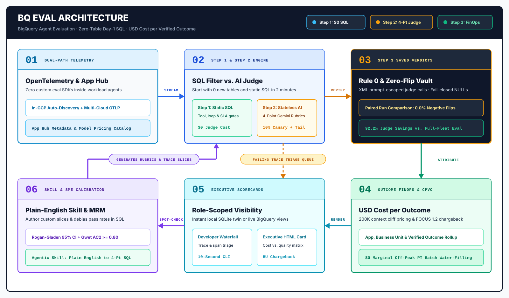
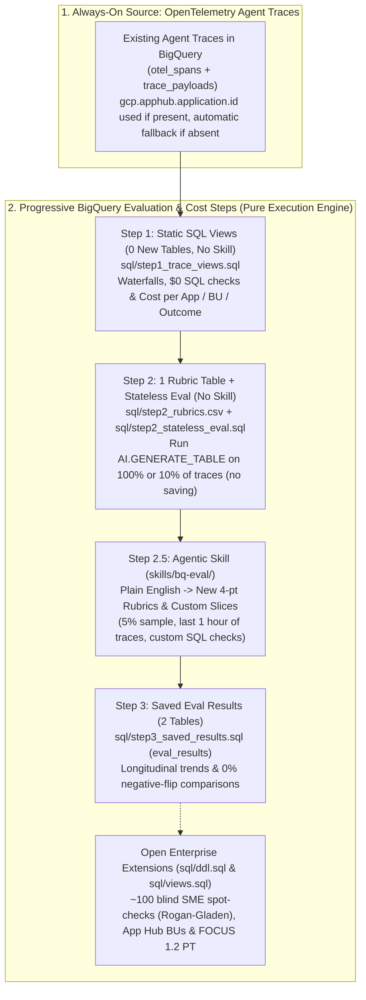

# BQ Eval (`bq-eval`) — BigQuery Agent Evaluation, Observability & FinOps Showcase



**BQ Eval (`bq-eval`)** turns **BigQuery** into a **pure execution engine** for AI agent monitoring, evaluation, and cost management in one continuous cycle—centered on **USD Cost per Verified Outcome**.

The source of data is **always OpenTelemetry traces**. Instead of forcing teams to set up 7 tables, custom SDKs, or human labeling panels on Day 1, `bq-eval` provides a **progressive onboarding path (`Step 1 → Step 2 → Step 2.5 Skill → Step 3`)** where you can start with **`0` new tables and static SQL** in 2 minutes and add rubrics, plain-English skills, and saved result tables only as you need them.

---

## 1. 30-Second Pitch, Progressive Architecture & Who It Is For

### 30-Second Elevator Pitch
> Monitoring, evaluation, and cost management of AI agents are not separate disciplines—they are one continuous cycle centered on **Cost per Verified Outcome**: what you pay for an agent interaction that actually succeeds for the business. **BQ Eval (`bq-eval`)** uses **BigQuery as a pure execution engine** over standard OpenTelemetry traces (`0` custom evaluation or billing SDK lines inside workload agents). On Day 1 (**Step 1**), predefined static SQL views run directly over existing traces (`0` new tables, `app.id` optional) to deliver waterfalls, `$0` deterministic health checks, and **Cost per Application, Business Unit, and Outcome**. In **Step 2**, adding a single `rubrics` table (or CSV in Cloud Storage) lets you run stateless Gemini evaluations on **100% of traces** or a **10% sample** without setting up result tables. In **Step 2.5**, the bundled **Agentic Skill (`skills/bq-eval/`)** translates plain English into new 4-point rubrics and custom trace slices (**5% sample**, **only the last 1 hour of traces**, or error outliers). In **Step 3**, saving outputs to `eval_results` unlocks `0%` negative-flip regression gates and longitudinal trends—while keeping `~100` blind human spot-checks (`Rogan-Gladen` calibration) and `FOCUS 1.2` Provisioned Throughput sizing open as optional enterprise extensions.

### Progressive Adoption Ladder (`Step 1 → Step 2 → Step 2.5 Skill → Step 3 → Open Extensions`)

| Stage | Tables Required | Skill Needed? | Files to Use | What You Get |
| :--- | :--- | :--- | :--- | :--- |
| **Step 1: Basic Trace Evals & Cost per Outcome** | **`0` new tables**<br/>*(Existing traces only)* | **No**<br/>*(100% static SQL)* | [`sql/step1_trace_views.sql`](sql/step1_trace_views.sql) | Predefined views (`v_step1_trace_waterfall`, `v_step1_trace_eval`, `v_step1_cost_per_outcome`). Uses `gcp.apphub.application.id` when present or falls back automatically. Delivers latency P95, tool/loop error checks at `$0` judge cost, and **Day-1 Cost per Application, Business Unit & Outcome**. |
| **Step 2: `1` Rubric Table + Stateless Eval** | **`1` table: `rubrics`**<br/>*(Or CSV in GCS)* | **No**<br/>*(Static SQL for `100%` & `10%`)* | [`sql/step2_rubrics.csv`](sql/step2_rubrics.csv)<br/>[`sql/step2_stateless_eval.sql`](sql/step2_stateless_eval.sql) | 4 ready-to-run 4-point ordinal rubrics (`groundedness_4pt_v1`, `tool_trajectory_4pt_v1`, `completeness_4pt_v1`, `escalation_policy_4pt_v1`) + static `AI.GENERATE_TABLE` queries to evaluate **100% of traces** or a **10% sample** on the fly without saving results. |
| **Step 2.5: Agentic Skill (`bq-eval`)** | Same `1` rubric table | **Yes**<br/>([`skills/bq-eval/SKILL.md`](skills/bq-eval/SKILL.md)) | [`skills/bq-eval/SKILL.md`](skills/bq-eval/SKILL.md)<br/>[`skills/bq-eval/references/sql_recipes.md`](skills/bq-eval/references/sql_recipes.md) | Use your coding agent to **define new 4-point rubrics from plain English**, run custom slices (**5% sample**, **only the last 1 hour of traces**, error/latency outliers, per-app filters), or generate custom domain Step-1+ SQL checks. |
| **Step 3: Saved Eval Outputs** | **`2` tables: `rubrics` + `eval_results`** | Optional | [`sql/step3_saved_results.sql`](sql/step3_saved_results.sql) | Persist evaluation verdicts (`eval_run_id`) into `agent_eval.eval_results` for repeatable runs, paired model/prompt comparisons (`v_step3_paired_run_comparison` for `0%` negative flips), and longitudinal quality/cost trends. |
| **Open Enterprise Extensions** | Optional (`sme_labels`, `app_registry`, `model_pricing_catalog`) | Optional | [`sql/ddl.sql`](sql/ddl.sql)<br/>[`sql/views.sql`](sql/views.sql) | Plug in `~100` blind human spot-checks (`sme_labels`) for Rogan-Gladen 95% CIs and Gwet's `AC2 >= 0.80`, App Hub registries, multi-cloud pricing catalogs, and `FOCUS 1.2` Provisioned Throughput sizing. |

### Who Is It For? (Three Enterprise Personas)

| Persona | Core Problem Solved | What BQ Eval Delivers |
| :--- | :--- | :--- |
| **1. Agent Product Developers**<br/>*(Engineering teams building and iterating on business workload agents)* | Tool errors and `429` retry storms hide in text logs; writing judge pipelines takes days; downgrading models to save money breaks working cases (`Negative Flips`). | • **Day 1 (`0` tables)**: Inspect `100%` of traces and `$0` SQL checks via `v_step1_trace_waterfall` and `v_step1_trace_eval`.<br/>• **Step 2 / 2.5**: Run stateless Gemini evaluations on `100%`, `10%`, `5%`, or the `last 1 hour` of traces.<br/>• **Step 3**: Compare candidate models/prompts in `v_step3_paired_run_comparison` (`Negative Flip Rate == 0.0%`). |
| **2. AI Platform, SRE & FinOps Engineers**<br/>*(Platform teams operating shared telemetry, PT reservations, and chargeback)* | Multi-cloud agents lack unified BU tags; LLM-judge spend rivals production spend; `>200K` context cliffs (`7.5x` output), `1/N` cache dilution, and `3x` idle-PT penalties distort unit economics. | • **Day 1 (`0` tables)**: **Cost per Application, Business Unit & Outcome** (`v_step1_cost_per_outcome`) with built-in `<=200K` and `>200K` cliff rates.<br/>• **`90–95%` Eval FinOps savings** via `$0` Step-1 SQL filtering + `5–10%` stratified sampling.<br/>• `FOCUS 1.2` Two-Pool Chargeback + **`$0` marginal off-peak PT batch-eval water-filling**. |
| **3. Quality Governance & Risk Teams**<br/>*(Teams certifying AI reliability and approving model upgrades by risk tier)* | Raw LLM judges inflate accuracy by `5–15pp`; high pass rates (`>85%`) collapse Krippendorff's $\alpha$; unjudged apps silently default to `100%` pass. | • Fail-closed `NULL` (`UNJUDGED`) handling so unjudged workloads never masquerade as `100%` passing.<br/>• **Rogan-Gladen / PPI** debiased pass rates with 95% confidence intervals + prevalence-robust **Gwet's AC2 $\ge 0.80$** over `~100` blind SME labels (`sme_labels`). |

---

## 2. Start Here: New User Onboarding Guide

### 2A. Try Locally in 10 Seconds (Zero Cloud Credentials Required)

Run the offline SQLite twin showcase, inspect the Cost per Verified Outcome scorecard, and verify all 19 tests locally:

```bash
# 1. Run the Showcase Demo (prints the Markdown Executive Scorecard)
python3 -m bq_eval.cli demo

# 2. Generate the self-contained interactive HTML Executive Scorecard (with SVG favicon)
python3 -m bq_eval.cli demo --html-out /tmp/bq_eval_scorecard.html

# 3. Time-shift & multiply the 4-App Golden Captured Trace Corpus (800 traces, 240 in last 1h)
python3 -m bq_eval.cli loadgen --replicas 50 --last-hour-replicas 15

# 4. Generate a parameterized BigQuery AI.GENERATE_TABLE judge SQL query (e.g., 5% canary)
python3 -m bq_eval.cli judge-sql \
  --project-id my-gcp-project \
  --dataset-id agent_eval \
  --rubric-id groundedness_4pt_v1 \
  --canary-pct 5

# 5. Run the standalone Python example script
python3 examples/run_showcase_demo.py

# 6. Run the linter and full verification suite (20 tests)
ruff check --no-cache bq_eval tests examples
pytest -p no:cacheprovider -v
```

---

### 2B. Step 1 on BigQuery (`0` New Tables, No Skill — 2 Minutes)

**Prerequisite**: You have OpenTelemetry spans in BigQuery (`agent_eval.otel_spans`; see [`sql/otel_spans_schema.json`](sql/otel_spans_schema.json) or point the `FROM` clause in [`sql/step1_trace_views.sql`](sql/step1_trace_views.sql) at your existing span table). `gcp.apphub.application.id` and `business_unit` are **optional**—the views use them if present and fall back to `'unregistered_app'` / `'unassigned_bu'` if absent.

```bash
# Optional (Demo Project): Populate or time-shift 800 traces (4 apps across ADK, LangGraph, MCP,
# Agent Engine & Cloud Run, with 240 traces in the last 1 hour) into CURRENT_TIMESTAMP() in <2s
bq query --project_id=YOUR_PROJECT --use_legacy_sql=false < sql/demo_time_shift_loadgen.sql

# Deploy the 3 static Step-1 views (v_step1_trace_waterfall, v_step1_trace_eval, v_step1_cost_per_outcome)
bq query --project_id=YOUR_PROJECT --use_legacy_sql=false < sql/step1_trace_views.sql
```

Then run the static Step-1 queries in BigQuery Console:
```sql
-- 1. Day-1 Cost per Application, Business Unit & Outcome ($0 LLM judge cost)
SELECT *
FROM `agent_eval.v_step1_cost_per_outcome`
ORDER BY total_cost_usd DESC;

-- 2. Triage failing traces (tool errors, retry loops > 8 calls, or span errors)
SELECT
  trace_id, apphub_application_id, business_unit, trace_start_time,
  trace_latency_ms, tool_call_count, tool_error_count, trace_cost_usd
FROM `agent_eval.v_step1_trace_eval`
WHERE NOT step1_pass
ORDER BY trace_start_time DESC
LIMIT 100;
```

---

### 2C. Step 2 on BigQuery (`1` Rubric Table / CSV, `0` Result Tables, No Skill — 5 Minutes)

Step 2 adds **one table (`agent_eval.rubrics`)** seeded with 4 example 4-point ordinal rubrics ([`sql/step2_rubrics.csv`](sql/step2_rubrics.csv): `groundedness_4pt_v1`, `tool_trajectory_4pt_v1`, `completeness_4pt_v1`, `escalation_policy_4pt_v1`) and runs **stateless** `AI.GENERATE_TABLE` evaluations over your traces (`v_step1_trace_eval` joined with `trace_payloads`) without saving results:

```bash
# Option A (Cloud Storage CSV): upload sql/step2_rubrics.csv to your bucket and uncomment Option 2A in step2_stateless_eval.sql
# gsutil cp sql/step2_rubrics.csv gs://YOUR_EVAL_BUCKET/step2_rubrics.csv

# Option B (Native BigQuery table): creates agent_eval.rubrics, seeds the 4 example rubrics via MERGE,
# creates v_step2_trace_rubric_prompts, and runs static 100% or 10% stateless evaluations
bq query --project_id=YOUR_PROJECT --use_legacy_sql=false < sql/step2_stateless_eval.sql
```

- **Example 2A in [`sql/step2_stateless_eval.sql`](sql/step2_stateless_eval.sql)**: Evaluates **100% of traces** against `groundedness_4pt_v1` and returns `reasoning_trace`, `ordinal_score`, `verified_pass`, and `trace_cost_usd` directly in the query output.
- **Example 2B in [`sql/step2_stateless_eval.sql`](sql/step2_stateless_eval.sql)**: Evaluates a **deterministic 10% sample of traces** (`WHERE MOD(ABS(FARM_FINGERPRINT(trace_id)), 100) < 10`).

---

### 2D. Step 2.5 — Using the Agentic Skill (`skills/bq-eval/`)

When you want to go beyond the 4 default rubrics or the static `100%` / `10%` queries, point your coding agent at **[`skills/bq-eval/SKILL.md`](skills/bq-eval/SKILL.md)** (backed by **[`skills/bq-eval/references/sql_recipes.md`](skills/bq-eval/references/sql_recipes.md)**) and ask in plain English:

1. **Define a new rubric**:
   - *"Add a 4-point rubric checking that underwriting summaries explain the primary risk driver without promising coverage."*
   - Generates a validated 4-point ordinal rubric (`Score 1..4`, no neutral midpoint, `<untrusted_text>` guard, `reasoning_trace` first) and upserts it into [`sql/step2_rubrics.csv`](sql/step2_rubrics.csv) / `agent_eval.rubrics`.
2. **Run on 5% of traces**:
   - Adds `AND MOD(ABS(FARM_FINGERPRINT(trace_id)), 100) < 5` to `v_step2_trace_rubric_prompts`.
3. **Run on only the last 1 hour of traces**:
   - Adds `AND trace_start_time >= TIMESTAMP_SUB(CURRENT_TIMESTAMP(), INTERVAL 1 HOUR)`.
4. **Combine slices (e.g., 5% of the last 1 hour + 100% of failed/slow traces)** or **add custom domain Step-1+ SQL checks** (citation anchor matching, JSON schema checks, or tool-to-answer reconciliation).

---

### 2E. Step 3 — Saving Outputs for Trends & `0%` Flip Gates (`sql/step3_saved_results.sql`)

When you want to persist evaluation outputs for historical dashboards, regression gating, or failure mining:

```bash
bq query --project_id=YOUR_PROJECT --use_legacy_sql=false < sql/step3_saved_results.sql
```

This provisions:
- **`agent_eval.eval_results`**: Partitioned by `DATE(evaluated_at)` and clustered by `(apphub_application_id, rubric_id, trace_id)`, with an idempotent `INSERT ... FROM AI.GENERATE_TABLE` template that skips already-scored `(trace_id, rubric_id)` pairs.
- **`agent_eval.v_step3_eval_runs`**: Summarizes `step1_pass_rate`, `rubric_pass_rate`, and `verified_outcome_rate` per `eval_run_id`.
- **`agent_eval.v_step3_paired_run_comparison`**: Compares a baseline run against a candidate model/prompt run on the exact same `trace_id`s to enforce **`0%` negative flips** (`is_negative_flip = FALSE`).

---

### 2F. Open Enterprise Extensions (`sql/ddl.sql` & `sql/views.sql`)

When ready for full enterprise governance across multiple Business Units, deploy [`sql/ddl.sql`](sql/ddl.sql) and [`sql/views.sql`](sql/views.sql) to add:
- **`agent_eval.sme_labels`**: `~100` blind human spot-checks per rubric to compute **Rogan-Gladen / PPI** debiased pass rates with 95% confidence intervals and **Gwet's AC2 $\ge 0.80$** inside `v_agent_eval_and_finops_summary`.
- **`agent_eval.app_registry` & `agent_eval.model_pricing_catalog`**: Multi-cloud App Hub Business Unit mapping and effective-dated SKU pricing.
- **`agent_eval.v_capacity_hourly_burndown_export`**: Hourly weighted burndown export for `FOCUS 1.2` Two-Pool Chargeback and off-peak Provisioned Throughput batch-eval scheduling.

---

## 3. Progressive Architecture Diagram



---

## 4. Repository Structure

```text
bq-eval/
├── README.md                                   # Overview, progressive Step 1-3 onboarding guide & quickstart
├── AGENTS.md                                   # Operational rules & architecture map
├── CLAUDE.md -> AGENTS.md                      # Symlink for multi-agent compatibility
├── CRITICAL.md                                 # Non-negotiable evaluation, FinOps & hygiene invariants
├── DECISIONS.md                                # Architectural Decision Records (ADR-001 to ADR-007)
├── pyproject.toml                              # Hatchling build & `bq-eval` CLI entrypoint
├── cloudbuild.yaml                             # Google Cloud Build verification pipeline
├── skills/
│   └── bq-eval/
│       ├── SKILL.md                            # Step 2.5+ Agentic Skill (plain English -> rubrics & custom slice SQL)
│       └── references/
│           └── sql_recipes.md                  # Composable SQL recipes (5% sample, last 1 hour, custom domain checks)
├── docs/
│   ├── architecture-and-sql.md                 # Progressive Step 1-3 walkthrough, App Hub linkage & 7-table extension DDL
│   ├── finops-and-cost-management.md           # USD Cost per Verified Outcome, Eval ROI, Pareto & FOCUS 1.2
│   └── roadmap.md                              # Showcase delivery roadmap
├── sql/
│   ├── demo_time_shift_loadgen.sql             # Demo Loadgen: Capture-once, time-shift & multiply 4-app corpus into today/last 1h
│   ├── step1_trace_views.sql                   # Step 1: 0-table static SQL views & queries (Cost per App/BU/Outcome)
│   ├── step2_rubrics.csv                       # Step 2: 4 example 4-point rubrics (can be mounted from GCS CSV)
│   ├── step2_stateless_eval.sql                # Step 2: 1-table rubric setup + static 100% & 10% stateless eval SQL
│   ├── step3_saved_results.sql                 # Step 3: Saved eval_results table, run summaries & paired flip view
│   ├── ddl.sql                                 # Complete DDL including open enterprise extensions (sme_labels, etc.)
│   ├── otel_spans_schema.json                  # BigQuery JSON schema with promoted token & URI columns
│   └── views.sql                               # Full enterprise views (waterfall, rule0_eval, step1_cost, finops, capacity)
├── bq_eval/
│   ├── __init__.py                             # Public package API exports
│   ├── otel.py                                 # OTel gen_ai.*, <=200K/>200K burndown cliffs & COALESCE App ID resolution
│   ├── rubrics.py                              # 4-point ordinal RubricSpec, XML escaping & CANONICAL_RUBRICS
│   ├── calibration.py                          # ConfusionMatrix, Rogan-Gladen 95% CIs & Gwet's AC2
│   ├── sql_eval.py                             # Fail-closed SQLite evaluator & XML-escaped AI.GENERATE_TABLE SQL builder
│   ├── finops.py                               # Eval FinOps ROI, 1/N cache dilution, NFR=0% Pareto, FOCUS 1.2 & PT schedule
│   ├── loadgen.py                              # Capture-once, time-shift & multiply 4-app Golden Trace Corpus generator
│   ├── showcase.py                             # Offline enterprise showcase pipeline & HTML/Markdown scorecard generator
│   └── cli.py                                  # `bq-eval` CLI (`demo`, `loadgen`, and `judge-sql`)
├── examples/
│   └── run_showcase_demo.py                    # Standalone end-to-end showcase runner script
└── tests/
    ├── test_bq_eval_end_to_end.py              # Comprehensive unit, SQLite parity (< 1e-15) & Step 1-3 SQL pack tests
    ├── test_isolation_guard.py                 # AST import firewall test (with positive control)
    └── test_repo_hygiene.py                    # ADR-005 hygiene, spine caps & relative link integrity gate
```
