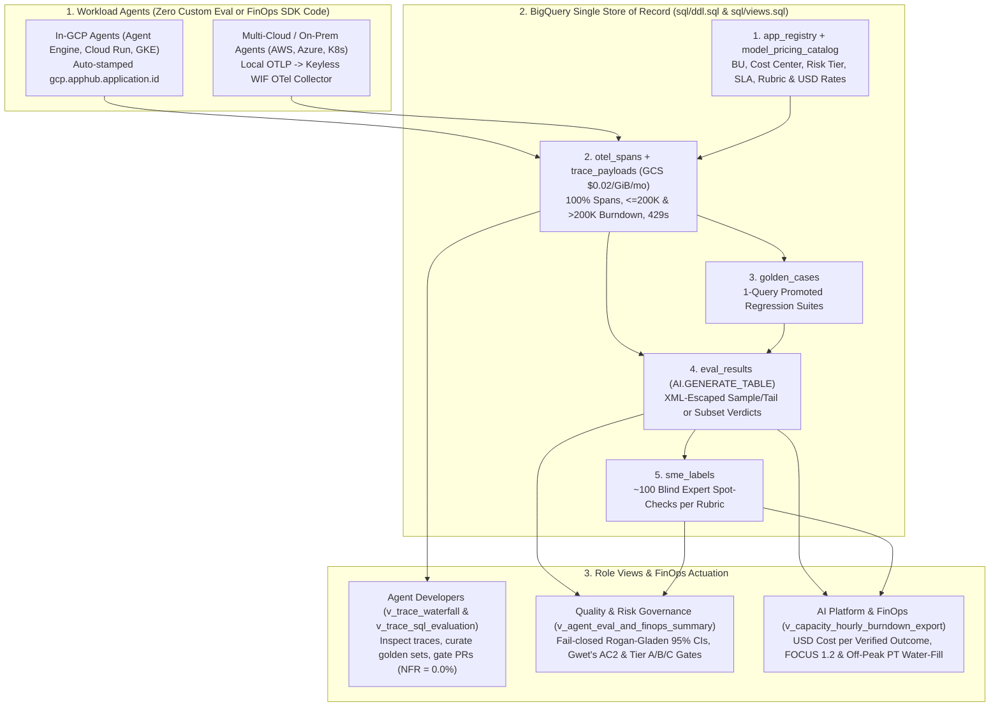

# BQ Eval (`bq-eval`) — Enterprise Agent Evaluation, Observability & FinOps Showcase

**BQ Eval (`bq-eval`)** is an **App Hub-enriched, BigQuery-native Enterprise Agent Evaluation, Observability, and Cost Management Showcase**. It connects `100%` of zero-code OpenTelemetry `gen_ai.*` agent traces to Business Unit, cost center, and risk-tier metadata inside a single BigQuery store—so engineering, risk, and FinOps teams can measure, govern, and optimize **USD Cost per Verified Outcome** without running extra operational databases or adding custom SDKs to workload agents.

---

## 1. 30-Second Pitch, Who It Is For & Main Benefits

### 30-Second Elevator Pitch
> When enterprises scale from one AI prototype to dozens of production agents across clouds, evaluation fragments into ad-hoc scripts, raw LLM judges inflate pass rates by `5–15` percentage points, and cloud billing tracks raw token spend with zero connection to business accuracy. **BQ Eval (`bq-eval`)** turns **Google Cloud App Hub + BigQuery** into a single, zero-extra-database **Agent Evaluation, Observability, and Cost Management Control Plane**. Teams register each AI application once in App Hub (`Business Unit`, `cost center`, `criticality tier`, `latency SLA`, and `default rubric`) while workload agents emit standard OpenTelemetry spans with **zero custom evaluation or FinOps SDK code**. Inside BigQuery—or locally in `<2 seconds` via `bq-eval demo`—BQ Eval runs `$0` deterministic `Rule 0` gates and multi-cloud USD/burndown attribution across `100%` of traffic, executes injection-hardened Gemini judge rubrics (`AI.GENERATE_TABLE`) on a `5–10%` sample + error/SLA tail or on-demand developer slice, debiases accuracy against `~100` blind SME spot-checks (`Rogan-Gladen` + `Gwet's AC2`), and bridges directly into Provisioned Throughput sizing and `FOCUS 1.2` chargeback—so developers ship zero-flip upgrades fast, risk teams certify models by criticality tier, and FinOps optimizes **USD Cost per Verified Outcome** across every Business Unit.

### Who Is It For? (Three Enterprise Personas)

| Persona | Core Problem Solved | What BQ Eval Delivers |
| :--- | :--- | :--- |
| **1. Agent Product Developers**<br/>*(Engineering teams building and iterating on business workload agents)* | Tool errors and `429` retry storms hide in text logs; curating golden regression sets from production takes days; downgrading models breaks working cases (`Negative Flips`). | • Inspect `100%` of traces out of the box (`v_trace_waterfall`, `v_trace_sql_evaluation`) with `0` custom SDK lines.<br/>• Promote production traces to `golden_cases` in 1 SQL query (`build_promote_traces_to_golden_sql`).<br/>• Run on-demand subset evaluations (`build_ai_generate_table_judge_sql`) and gate upgrades/downgrades on `Negative Flip Rate (NFR) == 0.0%`. |
| **2. AI Platform, SRE & FinOps Engineers**<br/>*(Platform teams operating shared telemetry, PT reservations, and chargeback)* | Multi-cloud agents lack unified BU tags; LLM-judge spend rivals production spend; `>200K` context cliffs (`7.5x` output), `1/N` cache dilution, and `3x` idle-PT penalties distort unit economics. | • Single BigQuery store (`$0.02/GiB/mo` GCS payloads) across GCP (`Agent Engine`, `Cloud Run`, `GKE`) and off-GCP (`AWS`, `Azure`, on-prem via keyless WIF).<br/>• 4-bucket USD attribution (`production_inference`, `conflict_escalation`, `agent_gym_eval`, `autorater_judge`) + **`90–95%` Eval FinOps savings**.<br/>• `FOCUS 1.2` Two-Pool Chargeback + **`$0` marginal off-peak PT batch-eval water-filling**. |
| **3. Quality Governance & Risk Teams**<br/>*(Teams certifying AI reliability and approving model upgrades by risk tier)* | Raw LLM judges inflate accuracy by `5–15pp`; high pass rates (`>85%`) collapse Krippendorff's $\alpha$; unjudged apps silently default to `100%` pass. | • Fail-closed `NULL` (`UNJUDGED`) handling so unjudged workloads never masquerade as `100%` passing.<br/>• **Rogan-Gladen / PPI** debiased pass rates with 95% confidence intervals + prevalence-robust **Gwet's AC2 $\ge 0.80$** over `~100` blind SME labels (`sme_labels`).<br/>• Automated `Tier A / B / C` release gates bound to App Hub `criticality_tier`. |

### Six Quantified Showcase Benefits (`B1`–`B6`)
1. **`B1` — Zero Workload SDK Coupling & `$0.02/GiB/month` Multi-Cloud Capture**: `0` custom agent SDK lines; `96%` lower payload archival cost via Cloud Storage Object Tables (`trace_payloads`) vs. `$0.50/GiB` log ingestion.
2. **`B2` — `90–95%` Lower Evaluation Spend ("Eval FinOps") + `$0` Off-Peak PT Water-Filling**: `$0` `Rule 0` SQL gates across `100%` of traces + `5–10%` canary & `100%` error/SLA-tail sampling + zero-decode System-1 logprob pre-screening + overnight idle PT batch judging.
3. **`B3` — Statistically Debiased Quality & Fail-Closed Governance**: Eliminates `5–15pp` raw LLM-judge bias via `Rogan-Gladen` 95% CIs and `Gwet's AC2 >= 0.80`, with fail-closed `NULL` guards on unjudged workloads.
4. **`B4` — Multi-Cloud `USD Cost per Verified Outcome` & Serving Physics**: Joins `model_pricing_catalog` across 4 `FinOpsTrafficType` buckets, modeling `<=200K` (`1.0x/0.1x/4.0x`) and `>200K` (`2.0x/0.2x/7.5x`) PT burndown cliffs, `429` retry waste, and `1/N` prefix-cache dilution.
5. **`B5` — Safe `3x–10x` Model Right-Sizing at `NFR = 0.0%` & Prompt Compression**: Cost-vs-Quality Pareto simulator proving safe migration from `gemini-4-argon` to `gemini-3.8-flash` / `gemini-3.5-flash-lite` at `0.0%` negative flips, paired with `-38% to -60%` prompt token compression.
6. **`B6` — Fair `FOCUS 1.2` Two-Pool Chargeback & `<2s` Zero-Auth Onboarding**: Eliminates the `3x` idle-PT penalty on `8x5` business-hours teams (`Active Consumed` vs. `Unallocated Idle`) and runs end-to-end locally in `<2 seconds`.

---

## 2. 60-Second Runnable Showcase Quickstart

Run the complete multi-Business-Unit evaluation, blind-SME calibration, and FinOps scorecard locally in `<2 seconds` with zero cloud credentials required:

```bash
# 1. Run the 3-Business-Unit Showcase Demo (Markdown Executive Scorecard)
python3 -m bq_eval.cli demo --format markdown

# 2. Generate the self-contained interactive HTML Executive Scorecard (with SVG favicon)
python3 -m bq_eval.cli demo --format html --output /tmp/bq_eval_scorecard.html

# 3. Inspect active FinOps levers (Eval ROI, Pareto NFR=0% right-sizing, FOCUS 1.2 chargeback & PT water-filling)
python3 -m bq_eval.cli finops

# 4. Print parameterized BigQuery DDL & Views for deployment
python3 -m bq_eval.cli sql --project my-gcp-project --dataset agent_evals_prod

# 5. Run the verification suite
pytest -p no:cacheprovider -v
```

---

## 3. Simplified 3-Layer Architecture (App Hub + BigQuery Single Store)



### 4-Stage Progressive Adoption Ramp
- **Stage 1 — Zero-Auth Local Evaluation (`< 5 min`)**: Run `bq-eval demo` locally over synthetic or exported spans using `evaluate_traces_rule0_in_memory()` and `AtomicRubric`.
- **Stage 2 — BigQuery `$0` Health, Golden Sets & Multi-Cloud USD Spend (`Day 1`)**: Deploy `sql/ddl.sql` and `sql/views.sql` (`v_trace_waterfall`, `v_trace_sql_evaluation`) with `app_registry` and `model_pricing_catalog`.
- **Stage 3 — Calibrated Judging & Active FinOps Optimization (`Week 1`)**: Enable `AI.GENERATE_TABLE` (`5–10%` sample + `100%` error/SLA tail), `NFR = 0.0%` Pareto model right-sizing, and `FOCUS 1.2` Two-Pool Chargeback + off-peak PT batch-eval water-filling.
- **Stage 4 — Regulated `Tier B / Tier C` Governance (`Enterprise Scale`)**: Add `~100` blind SME labels (`sme_labels`) for Rogan-Gladen 95% CIs, Gwet's `AC2 >= 0.80`, Two-Sided HITL (`RAIR/RSR >= 0.80`), and automated `evaluate_release_gate()` enforcement.

---

## 4. Repository Structure

```text
bq-eval/
├── README.md                                   # Showcase overview, 3 personas, B1-B6 benefits, quickstart
├── AGENTS.md                                   # Operational rules & architecture map
├── CLAUDE.md -> AGENTS.md                      # Symlink for multi-agent compatibility
├── CRITICAL.md                                 # Non-negotiable evaluation, FinOps & hygiene invariants
├── DECISIONS.md                                # Architectural Decision Records (ADR-001 to ADR-007)
├── pyproject.toml                              # Hatchling build & `bq-eval` CLI entrypoint
├── cloudbuild.yaml                             # Google Cloud Build verification pipeline
├── docs/
│   ├── architecture-and-sql.md                 # App Hub In-GCP/Off-GCP linkage, 7-table DDL & SQL cookbook
│   ├── finops-and-cost-management.md           # USD Cost per Verified Outcome, Eval ROI, Pareto & FOCUS 1.2
│   └── roadmap.md                              # Showcase delivery roadmap
├── sql/
│   ├── ddl.sql                                 # Complete DDL for 7 BigQuery tables + gemini_4_argon_judge model
│   ├── otel_spans_schema.json                  # BigQuery JSON schema with promoted token & URI columns
│   └── views.sql                               # 4 views: waterfall, rule0_eval, finops_summary, capacity_export
├── bq_eval/
│   ├── __init__.py                             # Public package API exports
│   ├── otel.py                                 # OTel gen_ai.*, <=200K/>200K burndown cliffs, W3C/XCTC, ring buffer
│   ├── rubrics.py                              # 7-Rule AtomicRubric ({2,3,4} steps), XML escaping, built-in rubrics
│   ├── calibration.py                          # IRR (alpha, AC2), Rogan-Gladen 95% CIs, NFR, RAIR/RSR, System-1
│   ├── sql_eval.py                             # Fail-closed in-memory & SQL builders (escaped XML, 95% CIs, COALESCE)
│   ├── finops.py                               # Multi-cloud USD catalog, Eval ROI, cache dilution, Pareto, FOCUS 1.2
│   ├── showcase.py                             # 3-BU synthetic enterprise dataset & HTML/Markdown scorecard generator
│   └── cli.py                                  # `bq-eval` CLI (demo, evaluate, calibrate, finops, sql)
├── examples/
│   └── run_showcase_demo.py                    # Standalone end-to-end showcase runner script
└── tests/
    ├── test_bq_eval_end_to_end.py              # Comprehensive unit & SQLite parity tests (< 1e-15 tolerance)
    ├── test_isolation_guard.py                 # AST import firewall test (with positive control)
    └── test_repo_hygiene.py                    # ADR-005 hygiene, spine caps & relative link integrity gate
```
