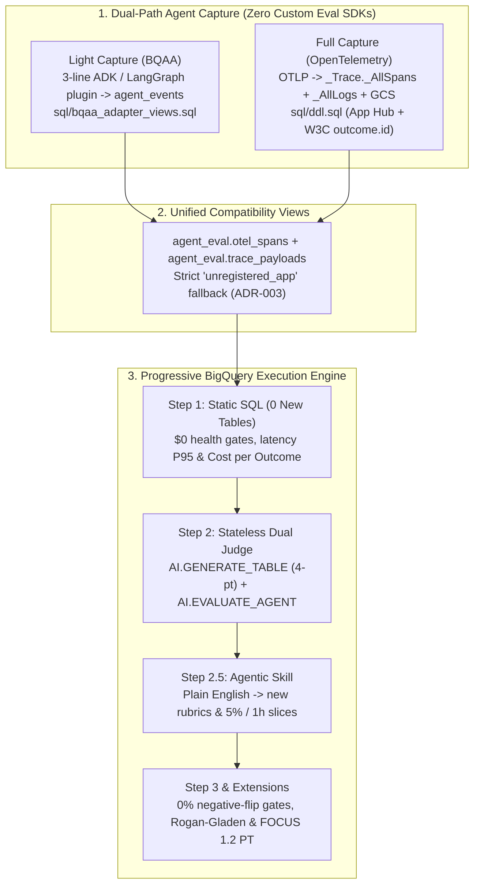

# BQ Eval & FinOps (`bq-eval`)


**BQ Eval & FinOps (`bq-eval`)** turns **BigQuery** into a single SQL execution engine for AI agent monitoring, statistical judge calibration, and unit-cost FinOps centered on **USD Cost per Verified Outcome**.

Teams capture agent activity through **two compatible ingestion lanes** without writing custom evaluation or billing SDKs inside workload agents:
- **Light Capture (`BQAA` — 3 Lines of Python, 1 Table)**: Stream events from Google ADK (`BigQueryAgentAnalyticsPlugin`), LangGraph (`BigQueryCallbackHandler`), or BigQuery Conversational Analytics directly into `agent_events`, then map them zero-copy via [`sql/bqaa_adapter_views.sql`](sql/bqaa_adapter_views.sql).
- **Full Capture (`OTel` — Multi-Service & Multi-Cloud Fleets)**: Stream standard OpenTelemetry spans and prompt/response payloads (`obs_traces._AllSpans` + `obs_logs._AllLogs` + Cloud Storage) with server-stamped App Hub attribution and cross-agent W3C `baggage` (`outcome.id`) via [`sql/ddl.sql`](sql/ddl.sql).

Both capture lanes feed the exact same **progressive adoption ladder (`Step 1 -> Step 2 -> Step 2.5 Skill -> Step 3`)**: start in 2 minutes with **`0` new tables and static SQL**, then add rubrics, plain-English skills, `0%` negative-flip regression gates, Rogan-Gladen human calibration, and `FOCUS 1.2` capacity chargeback only as you need them.

---

## 1. Core Thesis, Dual-Path Ladder & Who It Is For

### 30-Second Pitch
> Raw token dashboards hide whether an agent succeeded, raw LLM judges inflate pass rates by `5` to `15` percentage points, and running an LLM judge on `100%` of production traffic often costs as much as the agent itself. **BQ Eval & FinOps (`bq-eval`)** layers deterministic SQL gates, calibrated evaluation, and serving-physics FinOps directly over **BigQuery Agent Analytics (`BQAA`)** or **OpenTelemetry (`_AllSpans`)**. On Day 1 (**Step 1**), static SQL views run with `0` extra tables to catch tool errors and loops at `$0` judge cost and report **Cost per Application, Business Unit, and Outcome** across `<=200K` and `>200K` (`7.5x` output) context cliffs. **Step 2** adds a single `rubrics` table (or uses `AI.EVALUATE_AGENT` directly on `BQAA` turns) to score `100%` or a `10%` deterministic sample statelessly. **Step 2.5** pairs your coding agent with [`skills/bq-eval/`](skills/bq-eval/SKILL.md) to author 4-point rubrics and custom slices (`5%`, `last 1 hour`) from plain English. **Step 3** persists verdicts for `0.0%` negative-flip gates, while optional enterprise extensions add Rogan-Gladen 95% confidence intervals (`~100` blind SME labels) and `FOCUS 1.2` Provisioned Throughput water-filling.

### Dual-Path Capture Comparison ([`docs/bqaa-and-dual-path-architecture.md`](docs/bqaa-and-dual-path-architecture.md))

| Capture Lane | Best For | Setup Footprint | How It Feeds `bq-eval` |
| :--- | :--- | :--- | :--- |
| **Light Capture (`BQAA`)** | Individual ADK / LangGraph developers, fast PoCs, single-service agents | 3-line Python plugin -> 1 auto-created `agent_events` table (`0` Terraform, `0` external tables) | [`sql/bqaa_adapter_views.sql`](sql/bqaa_adapter_views.sql) maps `agent_events` zero-copy onto `otel_spans` & `trace_payloads` (deduplicating `event_id` retries and enforcing strict `'unregistered_app'` fallback) and filters `agent_events_eval_turn` for `AI.EVALUATE_AGENT`. |
| **Full Capture (`OTel`)** | Regulated multi-service enterprises, Cloud Run / Agent Runtime / GKE, AWS / Azure / on-prem via keyless WIF | Standard OTLP -> `telemetry.googleapis.com` (`_AllSpans` + `_AllLogs` + BigLake `completions`) | [`sql/ddl.sql`](sql/ddl.sql) reads linked Observability datasets with server-stamped `apphub.application.id` and multi-agent `EVAL-P11` `outcome.id` W3C baggage attribution. |
| **Hybrid Dual-Path** | Enterprises mixing central platform fleets with rapid developer sandboxes | `UNION ALL` compatibility view in [`sql/bqaa_adapter_views.sql`](sql/bqaa_adapter_views.sql) | Server-stamped `_AllSpans` traces take precedence; `BQAA`-only traces fill in automatically via `NOT EXISTS` on `trace_id`. |

### Progressive Adoption Ladder (`Step 1 -> Step 2 -> Step 2.5 Skill -> Step 3 -> Open Extensions`)

| Stage | Tables Required | Skill Needed? | Files to Use | What You Get |
| :--- | :--- | :--- | :--- | :--- |
| **Step 1: Trace Evals & Cost per Outcome** | **`0` new tables**<br/>*(Existing `otel_spans` or `BQAA` `agent_events`)* | **No**<br/>*(100% static SQL)* | [`sql/step1_trace_views.sql`](sql/step1_trace_views.sql)<br/>[`sql/bqaa_adapter_views.sql`](sql/bqaa_adapter_views.sql) | Predefined views (`v_step1_trace_waterfall`, `v_step1_trace_eval`, `v_step1_cost_per_outcome`, `v_cost_per_verified_outcome`). Enforces strict `'unregistered_app'` fallback when App Hub metadata is absent and delivers latency P95, `$0` SQL gates, and **Day-1 Cost per Application, Business Unit & Outcome**. |
| **Step 2: Stateless Dual-Engine Judge** | **`1` table: `rubrics`** *(Engine A)* or **`0` tables** *(Engine B)* | **No**<br/>*(Static SQL for `100%` & `10%`)* | [`sql/step2_rubrics.csv`](sql/step2_rubrics.csv)<br/>[`sql/step2_stateless_eval.sql`](sql/step2_stateless_eval.sql) | **Engine A (`AI.GENERATE_TABLE`)**: 6 canonical 4-point ordinal rubrics with XML prompt-injection escaping across all regions.<br/>**Engine B (`AI.EVALUATE_AGENT`)**: Scores Step-1 passing `BQAA` turns (`v_bqaa_eval_turn_filtered`) on 7 managed trajectory metrics. |
| **Step 2.5: Agentic Skill (`bq-eval`)** | Same as Step 2 | **Yes**<br/>([`skills/bq-eval/SKILL.md`](skills/bq-eval/SKILL.md)) | [`skills/bq-eval/SKILL.md`](skills/bq-eval/SKILL.md)<br/>[`skills/bq-eval/references/sql_recipes.md`](skills/bq-eval/references/sql_recipes.md) | Use your coding agent to define new 4-point rubrics from plain English, run custom slices (`5%` sample, `last 1 hour`, error/latency outliers, per-app filters), or author domain Step-1+ SQL checks. |
| **Step 3: Saved Eval Outputs & Quota Guard** | **`2` tables: `rubrics` + `eval_results`** *(+ optional `eval_daily_quota_config`)* | Optional | [`sql/step3_saved_results.sql`](sql/step3_saved_results.sql)<br/>[`sql/step3_daily_quota_guard.sql`](sql/step3_daily_quota_guard.sql) | Persist Engine A and Engine B verdicts (`eval_run_id`) into `agent_eval.eval_results` for repeatable runs, deduplicated paired comparisons (`v_step3_paired_run_comparison` for `0%` negative flips), and daily judge token caps (`v_step2_daily_quota_status`). |
| **Open Enterprise Extensions** | Optional (`sme_labels`, `app_registry`, `model_pricing_catalog`) | Optional | [`sql/ddl.sql`](sql/ddl.sql)<br/>[`sql/views.sql`](sql/views.sql)<br/>[`sql/demo_docubridge_extensions.sql`](sql/demo_docubridge_extensions.sql) | Plug in `~100` blind human spot-checks (`sme_labels`) for Rogan-Gladen 95% CIs and native SQL Quadratic Gwet's `AC2 >= 0.80`, App Hub registries, multi-cloud pricing catalogs (`examples/otel-collector-wif.yaml`), and `FOCUS 1.2` Provisioned Throughput sizing. |

### Three Enterprise Personas

| Persona | Core Problem Solved | What BQ Eval & FinOps Delivers |
| :--- | :--- | :--- |
| **1. Agent Product Developers**<br/>*(Teams building and iterating on workload agents)* | Tool errors and `429` retry storms hide in logs; setting up OTel collectors slows prototypes; downgrading models breaks working cases (`Negative Flips`). | • **3-Line Light Capture (`BQAA`)** or zero-SDK OTel.<br/>• **Day 1 (`0` tables)**: `$0` SQL gates and waterfalls (`v_step1_trace_eval`).<br/>• **Step 3**: Paired model/prompt gates (`Negative Flip Rate == 0.0%`). |
| **2. AI Platform, SRE & FinOps Engineers**<br/>*(Teams operating shared telemetry, PT reservations, and chargeback)* | Unregistered shadow agents hide behind service names; LLM-judge spend rivals production spend; `>200K` context cliffs (`7.5x` output), `1/N` cache dilution, and `3x` idle-PT penalties distort unit economics. | • Strict `'unregistered_app'` shadow-workload detection (`ADR-003`).<br/>• **`90` to `95%` Eval FinOps savings** via `$0` Step-1 SQL filtering + `5` to `10%` stratified sampling.<br/>• `FOCUS 1.2` Two-Pool Chargeback + **`$0` marginal off-peak PT batch-eval water-filling**. |
| **3. Quality Governance & Risk Teams**<br/>*(Teams certifying AI reliability and approving model upgrades)* | Raw LLM judges inflate accuracy by `5` to `15` percentage points; high pass rates (`>85%`) collapse Krippendorff's $\alpha$; unjudged apps silently default to `100%` pass. | • Fail-closed `NULL` (`UNJUDGED`) guards so unjudged workloads never appear `100%` passing.<br/>• **Rogan-Gladen / PPI** debiased pass rates with 95% confidence intervals + prevalence-robust **Gwet's AC2 $\ge 0.80$** over `~100` blind SME labels (`sme_labels`). |

---

## 2. Quickstart

### 2A. Run Locally in 10 Seconds (Zero Cloud Credentials Required)

Run the offline SQLite twin showcase, inspect the Cost per Verified Outcome scorecard, generate Engine A & Engine B SQL, and run all 54 verification tests locally:

```bash
# 1. Run the Showcase Demo (prints the Markdown Executive Scorecard)
python3 -m bq_eval.cli demo

# 2. Generate the self-contained interactive HTML Executive Scorecard (with SVG favicon)
python3 -m bq_eval.cli demo --html-out /tmp/bq_eval_scorecard.html

# 3. Time-shift & multiply the 4-App Golden Captured Trace Corpus (800 traces, 240 in last 1h)
python3 -m bq_eval.cli loadgen --replicas 50 --last-hour-replicas 15

# 4. Generate stratified Judge SQL for Engine A (AI.GENERATE_TABLE) or Engine B (AI.EVALUATE_AGENT)
python3 -m bq_eval.cli judge-sql --engine generate-table --project-id my-gcp-project --canary-pct 5
python3 -m bq_eval.cli judge-sql --engine evaluate-agent --project-id my-gcp-project --canary-pct 10

# 5. Run strict lint, typing, and full verification suite (54 tests incl. SQL contracts & BQAA parity)
ast-grep scan --rule specs/ast.rules.yaml
ruff format --check bq_eval tests examples scripts
ruff check --no-cache bq_eval tests examples scripts
mypy --strict bq_eval tests examples scripts
pytest -p no:cacheprovider -v
```

---

### 2B. Step 1 on BigQuery (`0` New Tables, No Skill — 2 Minutes)

Choose your capture source (**Light Capture `BQAA`** in `agent_eval.agent_events` or **Full Capture `OTel`** in `obs_traces._AllSpans`), then deploy the static Step-1 views:

```bash
# Option 1 (Light Capture — BQAA agent_events): deploy zero-copy BQAA adapter views
bq query --project_id=YOUR_PROJECT --use_legacy_sql=false < sql/bqaa_adapter_views.sql
# (Uncomment Mode A in sql/bqaa_adapter_views.sql if running BQAA standalone without _AllSpans)

# Option 2 (Demo Seed): populate 800 synthetic traces in isolated dataset agent_eval_seed in <2s
bq query --project_id=YOUR_PROJECT --use_legacy_sql=false < sql/demo_time_shift_loadgen.sql

# Deploy static Step-1 views (v_step1_trace_waterfall, v_step1_trace_eval, v_step1_cost_per_outcome, v_cost_per_verified_outcome)
bq query --project_id=YOUR_PROJECT --use_legacy_sql=false < sql/step1_trace_views.sql
```

Run the static Step-1 queries in BigQuery Studio:
```sql
-- 1. Day-1 Cost per Application, Business Unit & Outcome ($0 LLM judge cost)
SELECT *
FROM `agent_eval.v_step1_cost_per_outcome`
ORDER BY total_cost_usd DESC;

-- 2. Triage failing traces (tool errors, retry loops > 8 calls, or span errors)
SELECT
  trace_id, apphub_application_id, business_unit, trace_start_time,
  trace_latency_ms, tool_call_count, tool_error_count, trace_cost_usd
FROM `agent_eval.v_step1_trace_eval`
WHERE NOT step1_pass
ORDER BY trace_start_time DESC
LIMIT 100;
```

---

### 2C. Step 2 on BigQuery (Stateless Dual-Engine Evaluation — 5 Minutes)

```bash
# Creates agent_eval.rubrics, v_step2_trace_rubric_prompts, and runs stateless 100% / 10% evaluations
bq query --project_id=YOUR_PROJECT --use_legacy_sql=false < sql/step2_stateless_eval.sql
```

- **Engine A (`AI.GENERATE_TABLE` in [`sql/step2_stateless_eval.sql`](sql/step2_stateless_eval.sql))**: Works in all regions (including `US` and `EU` multi-regions) with 6 canonical 4-point ordinal rubrics (`groundedness_4pt_v1`, `tool_trajectory_4pt_v1`, `completeness_4pt_v1`, `escalation_policy_4pt_v1`, `kyc_policy_compliance_4pt_v1`, `rfp_quote_accuracy_4pt_v1`) and `<untrusted_text>` XML escaping.
- **Engine B (`AI.EVALUATE_AGENT` in [`sql/step2_stateless_eval.sql`](sql/step2_stateless_eval.sql) §6)**: Zero-model-setup option in single regions for scoring Step-1 passing `BQAA` turns (`v_bqaa_eval_turn_filtered`) against Google's 7 managed trajectory metrics.

---

### 2D. Step 2.5 (Agentic Skill) & Step 3 (Saved Results & Enterprise Extensions)

- **Step 2.5 ([`skills/bq-eval/SKILL.md`](skills/bq-eval/SKILL.md))**: Point your coding agent at `skills/bq-eval/SKILL.md` to author new 4-point rubrics from plain English, run `5%` or `last 1 hour` slices across either engine, or add domain Step-1+ SQL checks.
- **Step 3 ([`sql/step3_saved_results.sql`](sql/step3_saved_results.sql) & [`sql/step3_daily_quota_guard.sql`](sql/step3_daily_quota_guard.sql))**: Persist Engine A and Engine B verdicts into `agent_eval.eval_results` (`eval_run_id`) to track trends (`v_step3_eval_runs`), block model/prompt regressions (`v_step3_paired_run_comparison`, `is_negative_flip = FALSE`), and enforce daily judge token caps (`v_step2_daily_quota_status`).
- **Open Enterprise Extensions ([`sql/ddl.sql`](sql/ddl.sql), [`sql/views.sql`](sql/views.sql), [`examples/otel-collector-wif.yaml`](examples/otel-collector-wif.yaml))**: Add `sme_labels` (`~100` blind spot-checks for Rogan-Gladen 95% CIs + native SQL Quadratic Gwet's `AC2 >= 0.80`), `app_registry`, `model_pricing_catalog`, keyless multi-cloud OTel collection, and `v_capacity_hourly_burndown_export`.

---

### 2E. Measured Live Benchmark Receipts (343 Real Agent Executions on Generated Test Documents)

Verified end-to-end on Google Cloud across 3 registered multi-agent applications plus 1 unregistered shadow workload (`28,752` OTel spans, `443` closed outcomes, `_AllSpans` ingestion lag `p50 = 87 ms` / `p95 = 11.4 s`, `100.0%` attributed model spend across registered apps):

| Workflow & Comparison | Measured Result (Live SQL) | Key Takeaway |
| :--- | :--- | :--- |
| **Address Verification (KYC) 2-Stage Funnel** | `28/28` structural rejects + `8/8` PO Box traps caught at Step 1 (`$0`); Step-2 Flash judge caught `20/20` remaining semantic traps (**`100.0%` recall**, 95% Wilson CI `[83.9%, 100.0%]`, **`0/216` false positives**, `5/5` on a held-out trap omitted from the rubric) | `30/30` (`100.0%`) Flash-vs-Argon calibration agreement; SQL Quadratic Gwet's **`AC2 = 0.8605`** (`>= 0.80` pass); Rogan-Gladen **`86.84%`** `[82.78%, 90.90%]`; full judge cost `$0.0612` vs. projected 10% sample `$0.0061` (`90%` savings). |
| **Multi-Agent Procurement (RFP) Modality Cliff** | Structured A2A (`0` tokens, `$0.0000` AI / `$0.00024` w/ infra) vs. Flash PDF (`$0.00024` AI / `$0.00038` w/ infra) vs. misconfigured `>200K` Argon PDF (**`$0.7225` AI / `$0.7230` w/ infra**) | Single long-context misconfiguration created a **`~2,980×` AI cost cliff** for the same verified award; surfaced immediately by Step 1 SQL at `$0` judge cost. |
| **Commercial Loan Skill Evolution (Day 1 -> Day 2)** | Day-1 baseline `1.0.0`: **`$0.02427`** CPVO (incl. WORM storage), `1.00` human review per verified outcome, `30.8 s` avg cycle -> Day-2 compiled skill `1.1.0`: **`$0.000915`** CPVO (**`96.2%` drop**), `0.20` human reviews per outcome (**`80%` drop**), `5.5 s` avg cycle (`5.6×` faster) | `9/9` in-policy deals auto-approved with `0` escalations while `1/1` out-of-policy deal correctly escalated to human review. |
| **Shadow Workload Isolation (`ADR-003`)** | Unregistered service isolated automatically into `unregistered_app` (`0.0%` attribution coverage, `passes_coverage_gate = FALSE`) | Zero self-reporting required: missing App Hub registration is the detection signal in Step-1 SQL. |

---

## 3. Dual-Path Architecture Diagram



---

## 4. Repository Structure

```text
bq-eval/
├── README.md                                   # Dual-path overview, Step 1-3 onboarding & quickstart
├── AGENTS.md                                   # Operational rules & architecture map
├── CLAUDE.md -> AGENTS.md                      # Symlink for multi-agent compatibility
├── CRITICAL.md                                 # Non-negotiable evaluation, FinOps & hygiene invariants
├── DECISIONS.md                                # Architectural Decision Records (ADR-001 to ADR-008)
├── pyproject.toml                              # Hatchling build & `bq-eval` CLI entrypoint (`v0.2.2`)
├── uv.lock                                     # Locked dev & runtime dependencies (incl. ast-grep-cli)
├── cloudbuild.yaml                             # Google Cloud Build verification pipeline
├── specs/
│   └── ast.rules.yaml                          # Declarative ast-grep structural & security AST contract
├── skills/
│   └── bq-eval/
│       ├── SKILL.md                            # Step 2.5+ Agentic Skill (plain English -> rubrics & slices)
│       └── references/
│           └── sql_recipes.md                  # Composable SQL recipes (Engine A & Engine B)
├── docs/
│   ├── assets/architecture_card.svg            # Colorful Swiss Closed-Loop hero architecture card
│   ├── bqaa-and-dual-path-architecture.md      # Light Capture (BQAA) + Full Capture (OTel) design reference
│   ├── architecture-and-sql.md                 # Progressive Step 1-3 walkthrough & App Hub linkage
│   ├── finops-and-cost-management.md           # USD Cost per Verified Outcome, Eval ROI, Pareto & FOCUS 1.2
│   └── roadmap.md                              # Showcase delivery roadmap (M1-M9)
├── sql/
│   ├── bqaa_adapter_views.sql                  # Light Capture (BQAA) zero-copy views & Hybrid switchboard
│   ├── demo_time_shift_loadgen.sql             # Demo Loadgen: time-shift 4-app corpus into agent_eval_seed
│   ├── demo_docubridge_extensions.sql          # Optional DocuBridge WORM & KYC trap-recall extension views
│   ├── step1_trace_views.sql                   # Step 1: 0-table static SQL views (Cost per App/BU/Outcome)
│   ├── step2_rubrics.csv                       # Step 2: 6 canonical 4-point rubrics (GCS CSV mountable)
│   ├── step2_stateless_eval.sql                # Step 2: Engine A (AI.GENERATE_TABLE) & Engine B (AI.EVALUATE_AGENT)
│   ├── step3_saved_results.sql                 # Step 3: Saved Engine A/B eval_results & deduplicated 0% flip view
│   ├── step3_daily_quota_guard.sql             # Step 3: Daily judge token cap config, status view & scheduled guard
│   ├── ddl.sql                                 # Full Capture (_AllSpans/_AllLogs) views & enterprise DDL
│   ├── otel_spans_schema.json                  # BigQuery JSON schema (32 M1 columns + strict ADR-003 + payload URIs)
│   └── views.sql                               # Enterprise views (waterfall, rule0, CPVO, Gwet AC2, Rogan-Gladen, PT)
├── bq_eval/
│   ├── __init__.py                             # Public package API exports (`v0.2.2`)
│   ├── otel.py                                 # OTel gen_ai.*, <=200K/>200K cliffs & strict App ID resolution
│   ├── bqaa.py                                 # Light Capture BQAA event deduplication & span/payload adapter
│   ├── rubrics.py                              # 4-point ordinal RubricSpec, XML escaping & 6 CANONICAL_RUBRICS
│   ├── calibration.py                          # ConfusionMatrix, Rogan-Gladen 95% CIs & Quadratic Gwet's AC2
│   ├── sql_eval.py                             # Pure-SQLite view twin & Engine A / Engine B SQL builders
│   ├── finops.py                               # Eval FinOps ROI, cliff-aware cache dilution, Pareto & FOCUS 1.2
│   ├── loadgen.py                              # Time-shifted 4-app Golden Trace Corpus generator
│   ├── loadgen_seeds.py                        # 16 canonical Golden Trace Templates (33 spans/replica)
│   ├── showcase.py                             # Offline enterprise showcase pipeline & HTML/Markdown scorecards
│   └── cli.py                                  # `bq-eval` CLI (`demo`, `loadgen`, and `judge-sql`)
├── scripts/
│   └── bq_dry_run.py                           # Live BigQuery `--dry_run` validator across `sql/*.sql`
├── examples/
│   ├── otel-collector-wif.yaml                 # Keyless WIF OpenTelemetry Collector config (AWS/Azure/on-prem)
│   └── run_showcase_demo.py                    # Standalone end-to-end showcase runner script
└── tests/
    ├── standards_debt.json                     # Zero-debt standards ratchet baseline (`0` entries)
    ├── test_sql_contracts.py                   # SQL AST, schema alignment, fan-out & pure-SQLite contract suite
    ├── test_critical_paths.py                  # Boundary, cliff, calibration & CLI regression tests
    ├── test_bq_eval_end_to_end.py              # Unit, SQLite parity (< 1e-12) & Step 1-3 SQL pack tests
    ├── test_m1_allspans_compat_views.py        # M1 _AllSpans/_AllLogs & EVAL-P11 view contract tests
    ├── test_m5_bqaa_dual_path.py               # M5 BQAA Light Capture, strict ADR-003 & AI.EVALUATE_AGENT tests
    ├── test_isolation_guard.py                 # AST import firewall test (with positive control)
    └── test_repo_hygiene.py                    # ADR-005 hygiene, spine caps, AST rules & link integrity gate
```
