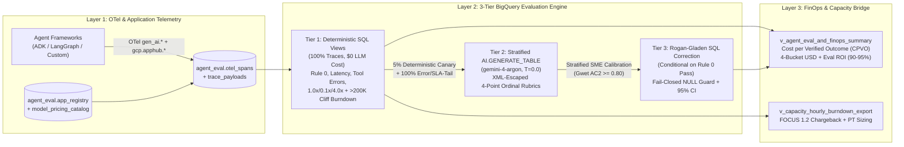

# BigQuery Architecture, 7-Table DDL & 3-Tier Evaluation Pipeline

## 1. End-to-End Architecture

`bq-eval` consolidates agent trace telemetry, deterministic `Rule 0` SQL evaluation, stratified LLM-as-a-Judge scoring, Rogan-Gladen bias correction, and 4-bucket FinOps cost attribution inside a single BigQuery dataset (`agent_eval`).



---

## 2. Complete 7-Table Physical BigQuery Schema (`sql/ddl.sql`)

Every table referenced by `sql/views.sql` and `bq_eval.sql_eval` is explicitly provisioned in [`sql/ddl.sql`](../sql/ddl.sql):

| Table / Model | Partitioning & Clustering | Purpose |
| :--- | :--- | :--- |
| `agent_eval.app_registry` | Clustered by `apphub_application_id, cost_center` | Maps `gcp.apphub.application.id` (or off-GCP agent IDs via `COALESCE`) to business unit, cost center, SLA (`sla_latency_ms`), and monthly token budget. |
| `agent_eval.otel_spans` | `DATE(start_time)` · Clustered by `apphub_application_id, trace_id, span_kind` | Streaming OTel `gen_ai.*` span sink (`invoke_agent`, `execute_tool`, `chat`, `retrieval`) with token counts (`input_tokens`, `cached_input_tokens`, `output_tokens`, `thinking_tokens`) and `finops_traffic_type`. |
| `agent_eval.trace_payloads` | `DATE(ingested_at)` · Clustered by `apphub_application_id, trace_id` | Sanitized prompt, retrieved context, and final response text for Tier 2 `AI.GENERATE_TABLE` judge execution. |
| `agent_eval.golden_cases` | Clustered by `apphub_application_id, rubric_id, risk_tier` | Version-controlled golden evaluation scenarios and expected invariants (`Rule 0` contracts, risk tiers). |
| `agent_eval.eval_results` | `DATE(evaluated_at)` · Clustered by `apphub_application_id, rubric_id, trace_id` | Output sink for Tier 2 `AI.GENERATE_TABLE` judge runs (`ordinal_score`, `binary_pass`, `judge_input_tokens`, `judge_output_tokens`, `judge_thinking_tokens`). |
| `agent_eval.sme_labels` | `DATE(labeled_at)` · Clustered by `apphub_application_id, rubric_id` | Stratified human SME audit labels (`human_pass`, `judge_pass`, `rule0_pass`) used to compute empirical $\widehat{\text{TPR}}$, $\widehat{\text{TNR}}$, Youden's $J$, and Gwet's $AC_2$. |
| `agent_eval.model_pricing_catalog` | Clustered by `model_name` | Effective-dated SKU pricing and serving-physics burndown multipliers (`<=200K` standard and `>200K` long-context cliffs). |
| `agent_eval.gemini_4_argon_judge` | Remote Cloud AI Model | Vertex AI remote connection model (`gemini-4-argon`, `T = 0.0`) invoked by `AI.GENERATE_TABLE`. |

---

## 3. Portable Application & Agent Identity Resolution (`EVAL-P07`)

Workloads running on GKE, Cloud Run, or Vertex AI Agent Engine emit `gcp.apphub.application.id`, whereas local development, multi-cloud, or OSS frameworks emit `gcp.agent.id` or `service.name`. Both `sql/views.sql` and `bq_eval.otel.resolve_application_id()` normalize application identity via the same deterministic precedence chain:

```sql
COALESCE(
  gcp_apphub_application_id,
  JSON_VALUE(attributes, '$."gcp.apphub.application.id"'),
  JSON_VALUE(attributes, '$."gcp.agent.id"'),
  NULLIF(service_name, 'agent-service'),
  'unregistered_app'
) AS apphub_application_id
```

---

## 4. Prompt-Injection Defense in `AI.GENERATE_TABLE` (`EVAL-P08`)

Untrusted user prompts (`p.user_prompt`), retrieved chunks (`p.retrieved_context`), and model responses (`p.final_response`) could contain literal `</untrusted_text>` tags designed to break out of the judge's XML boundary and spoof `<score>4</score>`.

`bq_eval.sql_eval.build_ai_generate_table_judge_sql()` enforces two hard safeguards:
1. **SQL-Level XML Entity Escaping:** Wraps `p.user_prompt`, `p.retrieved_context`, and `p.final_response` in nested `REPLACE(REPLACE(REPLACE(COALESCE(col, ''), '&', '&amp;'), '<', '&lt;'), '>', '&gt;')` before interpolating into `<untrusted_text>` blocks.
2. **Stratified Sampling Gate (`FARM_FINGERPRINT`):** Evaluates `100%` of deterministic failures (`NOT t.rule0_pass OR t.tool_error_count > 0 OR t.trace_latency_ms > t.sla_latency_ms`) plus a deterministic `5%` canary slice (`MOD(ABS(FARM_FINGERPRINT(t.trace_id)), 100) < 5`) of healthy traces, cutting judge token spend by `90–95%`.

---

## 5. Conditional Rogan-Gladen Calibration & Fail-Closed Guard (`EVAL-P05`)

Because Tier 2 semantic evaluation is conditioned on traces passing Tier 1 deterministic `Rule 0` checks ($P(\text{Verified Pass}) = P(\text{Rule 0 Pass}) \times P(\text{Semantic Pass} \mid \text{Rule 0 Pass})$):

1. **Conditional Prevalence ($\hat{p}_{\text{obs} \mid R_0}$):** `v_agent_eval_and_finops_summary` computes `raw_judge_pass_rate` strictly over judged traces where `rule0_pass = TRUE` (`AVG(CASE WHEN e.rule0_pass THEN CAST(e.binary_pass AS FLOAT64) END)`), while still billing `100%` of `autorater_judge_usd` across both canary and error/SLA-tail judge runs.
2. **Confusion-Matrix Filtering:** `sme_calibration` restricts rows to `WHERE rule0_pass = TRUE AND human_pass IS NOT NULL AND judge_pass IS NOT NULL` so unjudged audit rows never corrupt $\widehat{\text{TPR}}$ or $\widehat{\text{TNR}}$.
3. **Fail-Closed `NULL` Guard:** When `judged_samples = 0` or Youden's $J = \widehat{\text{TPR}} + \widehat{\text{TNR}} - 1 \le 10^{-6}$, `calibrated_pass_rate`, `calibrated_ci_95_lower`, `calibrated_ci_95_upper`, and `cost_per_verified_outcome_usd` return `NULL` (with `calibration_status = 'UNJUDGED'` or `'UNCALIBRATED'`), never fabricating a `100%` pass rate.
