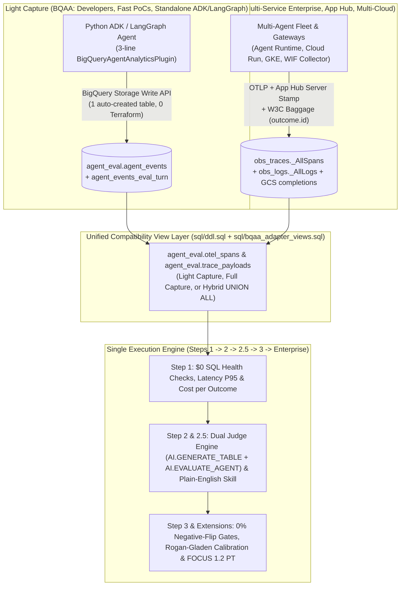

# Dual-Path Architecture: Light Capture (`BQAA`) + Full Capture (`OTel` `_AllSpans`)

> **Architecture Reference (`docs/bqaa-and-dual-path-architecture.md`)**
> Documents the **Dual-Path Capture -> Single Evaluation & FinOps Engine** architecture in **BQ Eval & FinOps (`bq-eval`)**: runtime trade-offs (`Agent Runtime` vs. `Cloud Run` vs. `Non-GCP`), App Hub linkage mechanics, `AI.EVALUATE_AGENT` integration alongside `AI.GENERATE_TABLE`, zero-copy SQL adapters ([`sql/bqaa_adapter_views.sql`](../sql/bqaa_adapter_views.sql)), and resolved `M5` design decisions.

---

## 1. Executive Summary & Core Thesis

### 1.1 Why Light Capture (`BQAA`) Exists Alongside Full Capture (`OTel` `_AllSpans`)
Standard OpenTelemetry (`telemetry.googleapis.com` -> `_Trace._AllSpans`) is ideal for enterprise platform engineering, but carries day-1 setup friction for individual developers and misses in-process agent-framework state:

1. **The "3-System OTel Tax" vs. 3 Lines of Python**:
   - Because OpenTelemetry spans enforce a `64 KiB` attribute ceiling (truncating long system prompts, RAG context, and multimodal payloads), capturing full prompts and completions via pure OTel without paying `$0.50/GiB` Cloud Logging ingestion fees requires provisioning **three separate systems**: `_Trace._AllSpans`, `_AllLogs` (`gen_ai.client.inference.operation.details`), and the OTel GenAI GCS upload hook + BigQuery Cloud Resource Connection + BigLake External Table (`agent_eval.completions`).
   - **What `BQAA` (`BigQueryAgentAnalyticsPlugin` for ADK and `BigQueryCallbackHandler` for LangGraph) does**: A 3-line Python plugin streams events directly via the **BigQuery Storage Write API** (`bigquerystorage.googleapis.com`) into a single auto-created `agent_events` table (with `auto_schema_upgrade=True`), keeping text up to `max_content_length` inline in `content` JSON and offloading oversized text or binary attachments (PDFs, images, audio) to Cloud Storage via `content_parts` object references on the same row.
2. **Framework-Internal State Invisible to Wire-Level OTel**:
   - Because `BQAA` hooks the ADK `Runner` (`BasePlugin`) / LangGraph callback loop in-process, it logs semantic state transitions that wire-level `generate_content` spans do not see:
     - **Full Candidate Tool Schemas (`attributes.tools`)**: Serializes the OpenAPI parameter schemas of **all tools available to the agent on that turn** (not just the tool invoked), which is required to evaluate whether the model selected the right tool.
     - **Session State Mutations (`attributes.state_delta`)**: Logs exact key-value diffs applied to agent session state.
     - **System Instruction Lineage (`static_instruction` vs. `instruction`) & Sub-Agent Transfers (`sub_agents`, `TRANSFER_A2A`)**.
     - **HITL Pause/Resume Boundaries (`attributes.adk.pause_kind`)**: Tracks long-running tool pauses and human-in-the-loop resumptions across invocations.
3. **Reconstructing the `AgentData` Proto for `AI.EVALUATE_AGENT`**:
   - Google Cloud's managed agent evaluation engine, including BigQuery's native **`AI.EVALUATE_AGENT`** Table-Valued Function (TVF), requires each turn or session to be formatted as a nested **`google.cloud.aiplatform.v1beta1.AgentData`** JSON proto (`agent_tree`, per-agent `instruction`, `tools[]` declarations, and ordered `turns[].events[]`).
   - `BQAA` automatically creates two companion views (`{table}_eval_turn` and `{table}_eval_session`) that assemble `agent_events` rows into `AgentData` JSON in a `trace` column alongside guardrail flags (`has_tool_loop` for `>= 3` consecutive identical tool calls and `has_truncated_content`).

---

### 1.2 The Dual-Path Architecture ("Light Capture from `BQAA`, Full Capture from `OTel`")

Instead of forcing every team onto one ingestion mechanism, **BQ Eval & FinOps (`bq-eval`)** sits on top of **both** capture lanes through its unified compatibility views (`agent_eval.otel_spans` and `agent_eval.trace_payloads` in [`sql/ddl.sql`](../sql/ddl.sql) and [`sql/bqaa_adapter_views.sql`](../sql/bqaa_adapter_views.sql)):



---

## 2. How `BQAA` Connects (and Does Not Connect Natively) to App Hub

### 2.1 Why Native `BQAA` Has Zero Automatic App Hub Stamping
1. **Server-Side Enrichment Only Runs on `telemetry.googleapis.com`**:
   - When OpenTelemetry spans are exported to `telemetry.googleapis.com`, Google Cloud's ingestion pipeline inspects `resource.attributes["gcp.resource.controller.id"]` / `cloud.resource.id` (populated by `GoogleCloudResourceDetector` with the full AIP-122 CAIS URI, such as `//run.googleapis.com/projects/.../services/...` or `//aiplatform.googleapis.com/projects/.../reasoningEngines/...`), resolves that URI against **App Hub (`apphub.googleapis.com`)**, and automatically stamps stored spans in `_Trace._AllSpans` with `apphub.application.id`, `apphub.service.id`, and `apphub.workload.id`.
2. **`BQAA` Bypasses `telemetry.googleapis.com`**:
   - `BigQueryAgentAnalyticsPlugin` and `BigQueryCallbackHandler` write directly from the Python process to `agent_events` via the **BigQuery Storage Write API** (`bigquerystorage.googleapis.com` using `BigQueryWriteAsyncClient.append_rows` on a `COMMITTED` PyArrow stream).
   - Because rows never pass through `telemetry.googleapis.com`, server-side App Hub enrichment never runs. Natively, `agent_events` only stores self-reported Python strings (`agent`, `attributes.root_agent_name`, `attributes.adk.app_name`).

### 2.2 Two Patterns to Connect `BQAA` to App Hub (`ADR-003` Strict Fallback)

| Pattern | Mechanism | When to Use |
| :--- | :--- | :--- |
| **Pattern 1: Join `agent_events.trace_id` to `_Trace._AllSpans.trace_id` (Hybrid Mode)** | When an **ambient OpenTelemetry span** is active in Python `contextvars` (`trace.get_current_span().get_span_context().is_valid`), `BQAA`'s `TraceManager.get_trace_id()` adopts the ambient 32-hex-char OTel `trace_id` (`format(ambient_ctx.trace_id, "032x")`) instead of falling back to `callback_context.invocation_id`. Joining `agent_events` to `_AllSpans` on `trace_id` inherits infrastructure-verified `apphub.application.id`. | **In-GCP (`Agent Runtime`, `Cloud Run`, `GKE`)** when OTLP telemetry is enabled alongside `BQAA`. |
| **Pattern 2: Inject `custom_metadata` in `BigQueryLoggerConfig`** | Pass `BigQueryLoggerConfig(custom_metadata={"apphub.application.id": "my-app", "business_unit": "commercial", "cost_center": "cc-101"})`. `BQAA` writes these keys into `attributes.custom_metadata.*` on every row. Any workload omitting `custom_metadata."apphub.application.id"` resolves strictly to `'unregistered_app'` (`ADR-003`), never collapsing into `adk.app_name` or `agent`. | **Light Capture / Non-GCP / Standalone `BQAA`** when `_AllSpans` is not enabled. |

> [!IMPORTANT]
> **`span_id` vs. `attributes.otel.span_id` Nuance in `BQAA`**
> The top-level `span_id` and `parent_span_id` columns in `agent_events` are **`BQAA`'s own internal `TraceManager` UUIDs** used to reconstruct the ADK agent/LLM/tool tree, not OpenTelemetry span IDs. If you need **span-level** correlation with `_AllSpans` (rather than trace-level correlation on `trace_id`), set `BigQueryLoggerConfig(log_otel_span_context=True)` (`False` by default), which snapshots the ambient OTel context into `attributes.otel.span_id` and `attributes.otel.trace_id` (automatically preferred by `v_bqaa_otel_spans`).

---

## 3. Runtime Behavior: Agent Runtime vs. Cloud Run vs. Non-GCP

| Dimension | 1. Agent Runtime (`ReasoningEngine`) | 2. Cloud Run (`run.googleapis.com/Service`) | 3. Non-GCP (`AWS`, `Azure`, `On-Prem`, `Workstations`) |
| :--- | :--- | :--- | :--- |
| **App Hub Discovery** | Auto-discovered via CAIS as `//aiplatform.googleapis.com/.../reasoningEngines/{ID}` (`functionalType=AGENT`). | Auto-discovered via CAIS as `//run.googleapis.com/projects/{P}/locations/{L}/services/{S}`. | Not auto-discovered by CAIS. Register a **logical App Hub `Application` shell** (plus optional writable `Service` in Agent Registry). |
| **How Light Capture (`BQAA`) Works** | • **Auth**: Uses the Reasoning Engine service account (`roles/bigquery.dataEditor` + optional `roles/storage.objectCreator`).<br/>• **Trace & App Hub Linkage**: When deployed with `GOOGLE_CLOUD_AGENT_ENGINE_ENABLE_TELEMETRY=true`, Agent Runtime opens an ambient root OTel span exported to `telemetry.googleapis.com`. `BQAA` automatically adopts that `trace_id`, so `agent_events.trace_id` joins 1:1 with `_AllSpans.trace_id`. | • **Auth**: Uses the Cloud Run service account via `metadata.google.internal`.<br/>• **Trace & App Hub Linkage**: Cloud Run injects an HTTP `traceparent` header, **not** an in-process Python OTel span. Unless the container initializes an OTel `TracerProvider` (`OTLPSpanExporter` -> `telemetry.googleapis.com` + `GoogleCloudResourceDetector`), `ambient_ctx.is_valid` is `False`, so `BQAA` falls back to `trace_id = invocation_id` and requires `custom_metadata={"apphub.application.id": "..."}` to leave `'unregistered_app'`.<br/>• **Lifecycle Gotcha**: Keep `flush_on_run_end=True` (default) on request-billed Cloud Run so background Storage Write API batches flush before CPU throttling. | • **In-Process GCP Dependencies & Credentials**: Every external container must install `google-cloud-bigquery-storage`, `pyarrow`, and `google-cloud-storage`, and hold active GCP credentials (`GOOGLE_APPLICATION_CREDENTIALS` WIF config) with direct egress to `bigquerystorage.googleapis.com:443`.<br/>• **Framework Scope**: Python **ADK** (`BigQueryAgentAnalyticsPlugin`) and **LangChain/LangGraph** (`BigQueryCallbackHandler`) only.<br/>• **App Hub Linkage**: Requires explicit `custom_metadata={"apphub.application.id": "..."}`. |
| **How Full Capture (`OTel` `_AllSpans`) Works** | • **Zero Extra Plugin Needed**: Native Agent Runtime OTLP spans land in `obs_traces._AllSpans` (`p50 ~2.3s`, `p95 ~5.1s` freshness) with server-side `apphub.application.id` stamping, while completion payloads upload to GCS (`agent_eval.completions`). | • **Standard OTel Only**: Cloud Run services emit OTLP to `telemetry.googleapis.com/v1/traces` with `GoogleCloudResourceDetector`.<br/>• `telemetry.googleapis.com` stamps `apphub.application.id` server-side from the Cloud Run URI; unregistered services resolve to `'unregistered_app'`. | • **Zero GCP SDKs or Creds in Workload Agents**: External agents (any language, Bedrock, Azure, `vLLM`) emit plain OTLP (`:4317`) to a local **OTel Collector**.<br/>• Collector authenticates keylessly via **Workload Identity Federation (`sts.googleapis.com`)**, stamps `apphub.application.id`, forwards spans to `telemetry.googleapis.com`, and batches payloads to GCS (or S3/ADLS via BigQuery Omni). |

---

## 4. How `BQAA` Evaluations (`AI.EVALUATE_AGENT`) Fit Into Steps 1–3

### 4.1 Two Generations of `BQAA` Evaluation
1. **Generation 1 (Python `bigquery-agent-analytics` SDK)**:
   - Pulls `agent_events` rows out of BigQuery into a Python process (`Client`, `GraderPipeline`, `CodeEvaluator`, `LLMAsJudge`) to reconstruct sessions and score them outside the warehouse.
2. **Generation 2 (Built-In `AI.EVALUATE_AGENT` SQL TVF — Q1 2027 Preview)**:
   - **Native built-in BigQuery Table-Valued Function (TVF)**: Requires **zero installation, zero `CREATE MODEL`, and zero `CREATE CONNECTION`**.
   - **SQL Signature**:
     ```sql
     SELECT *
     FROM AI.EVALUATE_AGENT(
       TABLE `project.dataset.v_bqaa_eval_turn_filtered`,
       trace_col => 'trace',
       managed_metrics => [
         'tool_use_quality_v1',
         'final_response_quality_v1',
         'hallucination_v1',
         'safety_v1'
       ]
     );
     ```
   - **Supported `managed_metrics` Modes (up to 50 metrics per query)**:
     - **7 Predefined Managed Metrics (`ARRAY<STRING>`)**:
       - *Turn / Trace-scoped (4)*: `tool_use_quality_v1`, `final_response_quality_v1`, `hallucination_v1`, `safety_v1`
       - *Session-scoped (3)*: `multi_turn_task_success_v1`, `multi_turn_tool_use_quality_v1`, `multi_turn_trajectory_quality_v1`
     - **Custom JSON Metrics & Rubric Generation (`JSON` literal)**: Supports `custom_metric`, `prompt_template`, `system_instruction`, `judge_model`, `sampling_count` (`1..32`), and static `rubrics` or dynamic `rubric_generation`.
   - **Operational Constraints of `AI.EVALUATE_AGENT`**:
     1. **Single-Region Allowlist Only (No `US` or `EU` Multi-Region Yet)**: Restricted to 15 single regions (`us-central1`, `us-east1`, `us-east4`, `us-east5`, `us-south1`, `us-west1`, `us-west4`, `europe-central2`, `europe-north1`, `europe-southwest1`, `europe-west1`, `europe-west4`, `europe-west8`, `europe-west9`), whereas `AI.GENERATE_TABLE` works in `US` and `EU` multi-regions today.
     2. **`AgentData` JSON Input Requirement**: `trace_col` must contain a valid `google.cloud.aiplatform.v1beta1.AgentData` JSON string (produced automatically by `BQAA`'s `{table}_eval_turn` and `{table}_eval_session` views).

### 4.2 Dual Judge Engines Inside the Progressive Ladder (`Step 1 -> Step 2 -> Step 3`)

| Stage | Role in Dual-Path Architecture |
| :--- | :--- |
| **Step 1 (`$0` SQL Gate & Cost per Outcome)** | **Pre-filters before any LLM judge runs**: Flags tool errors, infinite tool loops (`has_tool_loop` / `tool_call_count > 8`), and schema failures at `$0`, computes `<=200K` and `>200K` token spend, and selects a deterministic `5–10%` `FARM_FINGERPRINT(trace_id)` sample + `100%` error/SLA tail, saving **90–95% of `AI.EVALUATE_AGENT` or `AI.GENERATE_TABLE` judge spend**. |
| **Step 2 & 2.5 (Stateless Judge Execution)** | • **Engine A (`AI.GENERATE_TABLE`)**: Works today in all regions (including `US`/`EU`), enforces 4-point ordinal rubrics (`groundedness_4pt_v1` + plain-English Step 2.5 Skill rubrics), escapes `<untrusted_text>` against prompt injection, and records exact judge token usage.<br/>• **Engine B (`AI.EVALUATE_AGENT`)**: Zero-model-setup option (in single regions via `v_bqaa_eval_turn_filtered`) for scoring `BQAA` `AgentData` turns against Google's 7 built-in trajectory metrics (`bq-eval judge-sql --engine evaluate-agent`). |
| **Step 3 & Enterprise Extensions** | **Turns stateless scores into governed decisions**: Saves verdicts from either engine into `agent_eval.eval_results`, enforces **`0%` negative-flip regression gates** (`v_step3_paired_run_comparison`), debiases raw pass rates via **Rogan-Gladen / Gwet's `AC2 >= 0.80`** (`sme_labels`), and computes **USD Cost per Verified Outcome** (`v_cost_per_verified_outcome`). |

---

## 5. Base Information Comparison & Canonical Adapter Views

| Base Information Signal | Light Capture (`BQAA` `agent_events`) | Full Capture (`OTel` `_AllSpans` + `_AllLogs` + `completions`) |
| :--- | :--- | :--- |
| **Trace & Turn Identity** | `COALESCE(attributes.otel.trace_id, trace_id, invocation_id)`, `session_id`, `invocation_id` | W3C `trace_id`, `span_id`, `parent_span_id` across all services |
| **App Hub Application ID (`ADR-003`)** | Strict `COALESCE(attributes.custom_metadata."gcp.apphub.application.id", attributes.custom_metadata."apphub.application.id", 'unregistered_app')` (or joined from `_AllSpans`) | Server-side stamped `apphub.application.id` (from CAIS `cloud.resource.id`), falling back strictly to `'unregistered_app'` |
| **Prompts, Context & Responses** | Inline in `agent_events.content` (`USER_MESSAGE_RECEIVED`, `TOOL_COMPLETED`, `AGENT_RESPONSE`) + `content_parts` GCS refs | Joined from `obs_logs._AllLogs` + BigLake `agent_eval.completions` |
| **Token Usage & `<=200K`/`>200K` Cliffs** | `attributes.usage_metadata.{prompt_token_count, cached_content_token_count, candidates_token_count, thoughts_token_count}` on `LLM_RESPONSE` | `gen_ai.usage.{input_tokens, cache_read.input_tokens, output_tokens, reasoning.output_tokens}` |
| **Candidate Tool Declarations** | Full OpenAPI tool schemas in `attributes.tools` on `LLM_REQUEST` (enables `AgentData` reconstruction) | Not captured in standard OTel spans (only invoked `gen_ai.tool.name` is recorded) |
| **Multi-Agent Outcome Attribution (`EVAL-P11`)** | `COALESCE(attributes.custom_metadata."outcome.id", trace_id, invocation_id)` + `OUTCOME_CLOSED` event | Cross-service W3C `baggage` (`outcome.id`, `outcome.owner`) + zero-duration `outcome.closed` span |

See [`sql/bqaa_adapter_views.sql`](../sql/bqaa_adapter_views.sql) for the production SQL definitions (`v_bqaa_otel_spans`, `v_bqaa_trace_payloads`, `v_bqaa_eval_turn_filtered`, and the Light / Full / Hybrid mode switchboard) and [`bq_eval/bqaa.py`](../bq_eval/bqaa.py) for the deterministic Python twin.

---

## 6. Resolved `M5` Design Decisions (`2026-11-11`)

1. **Repository Slug & Title**: Keep repository slug **`bq-eval`** (`tvaroska/bq-eval`) for zero downstream consumer churn while retitling to **BQ Eval & FinOps** across docs, CLI, and scorecards.
2. **Capture Lane Terminology**: Standardize on **Light Capture (`BQAA`)** vs. **Full Capture (`OTel`)** everywhere (avoiding lettered capture-lane labels that collide with application-level `Path-A` A2A vs. `Path-B` PDF workflow lanes).
3. **Strict `ADR-003` `'unregistered_app'` Fallback in `BQAA`**: Neither `v_bqaa_otel_spans.gcp_apphub_application_id` nor `outcome_owner` falls back to self-reported `adk.app_name`, `root_agent_name`, or `agent`; unregistered workloads without explicit `custom_metadata` App Hub tags (or `_AllSpans` server-stamped join) surface strictly under `'unregistered_app'`.
4. **Dual Judge Engine Packaging**: Ship [`sql/bqaa_adapter_views.sql`](../sql/bqaa_adapter_views.sql) (`v_bqaa_eval_turn_filtered`) alongside `build_ai_evaluate_agent_sql()` (`bq-eval judge-sql --engine evaluate-agent`) so Step-1 `$0` SQL pre-filtering and `FARM_FINGERPRINT` sampling apply equally to `AI.GENERATE_TABLE` and `AI.EVALUATE_AGENT`.
